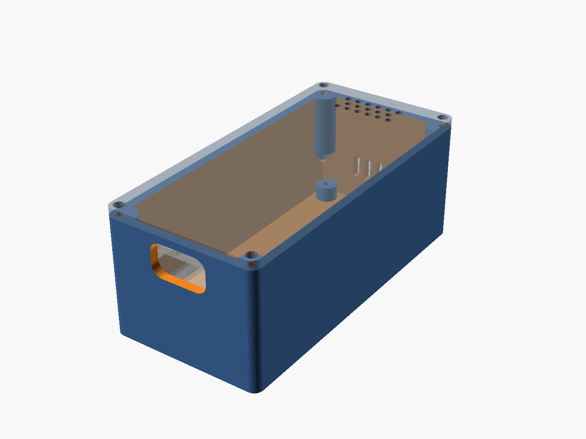

# SoundSpy node enclosure

Two-part case for the carrier PCB rev 1.2 (`pcb/inmp441/soundspy-node.kicad_pcb`) with an ESP32 38-pin DevKit on female socket strips.

Outer size: **34.8 × 72.8 × 28.7 mm** (base 26.7 mm + 2 mm lid).

| File | |
|---|---|
| `soundspy-case.scad` | Parametric source, every dimension is a named variable at the top |
| `stl/soundspy-case-base.stl` | Base, print as-is (floor on the bed) |
| `stl/soundspy-case-lid.stl` | Lid, already flipped: outer face on the bed |

Regenerate after changing a parameter: `./scripts/render_case.sh`. It runs the fit check first and fails if the case would collide with any board part. You can also override values without editing, e.g. `./scripts/render_case.sh -D socket_h=11`.

## Hardware

- 4× M2×5 thread-forming (or wood-thread) screws: carrier PCB → base standoffs
- 4× M2×8 screws: lid → corner columns
- Optional: 2 wall screws for the keyholes (head ≤ 7 mm, ≤ 3 mm tall)

## Print

- PLA or PETG, 0.2 mm layers, 3 perimeters, no supports. The lid-screw columns have 45° undersides, and the USB and sound slots bridge fine.
- Pilot holes are 1.7 mm (`m2_pilot`). If screws are too tight or loose on your printer, adjust that value and re-render.

## Assembly

1. Screw the carrier PCB onto the standoffs, with the USB notch toward the USB cutout.
2. Plug the ESP32 into its sockets. It goes on after the PCB screws because it covers the USB-end screws.
3. Lay the lid on with the grille over the mic end, then screw it into the four corners.

Sound reaches the mic through the lid grille and the five slots low in the mic-end wall. The case hangs on the keyholes with the mic end up and the USB cable exiting downward.

## Assumptions to check on the real board

These are the dimensions not defined by the KiCad file. If your parts differ, change them in the `.scad` file:

- `socket_h = 8.5`, `pin_spacer_h = 2.5`: standard female strip plus the ESP32's male-pin spacer
- `esp_w = 28`, `esp_l = 54.4`, `esp_usb_overhang = 2.4`: DevKitC-style 38-pin board
- `usb_h = 3.2`: USB connector height, which sets the cutout centre (19.3 mm above the floor)
- `usb_cut_w/h = 13 × 7.5`: sized for the cable's plug overmold, not the receptacle
